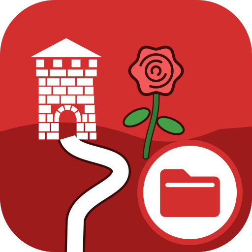

<h1 align="center">Rosenweg Files</h1>

Dateimanager für die Smartphones der Siedlung Rosenweg – Dateien auf dem Telefon und in der eigenen Rosenweg-Nextcloud.

<a href="https://www.rosenweg4303.ch/apps">Herunterladen</a> · <a href="docs/anleitung.md">Anleitung</a> · <a href="docs/entwickeln.md">Für Entwickler</a>

## Was die App kann

- Dateien auf dem Telefon und in der Rosenweg-Nextcloud durchsuchen, öffnen, hochladen, umbenennen und löschen.
- Die Nextcloud erscheint auch in der Dateiauswahl anderer Apps.
- Office-Dateien direkt in Euro-Office im Browser bearbeiten.
- Auf geteilten Telefonen landen Downloads automatisch in `Persönlich/Downloads`.
- Anmeldung mit dem Rosenweg-Konto – die App bekommt nie das eigentliche Passwort.

## Plattformen

Android.

## Entwickeln

Android-App (Kotlin) auf Basis von Fossify File Manager, gebaut gegen
[commons-rosenweg](https://github.com/Rosenweg/commons-rosenweg): `./gradlew assembleFossRelease` –
Bau, Signatur, Logo und Veröffentlichung stehen in [docs/entwickeln.md](docs/entwickeln.md).

## Herkunft und Lizenz

Basiert auf [Fossify File Manager](https://github.com/FossifyOrg/File-Manager) – herzlichen Dank an das Fossify-Team und alle Mitwirkenden.
GPL-3.0, siehe [LICENSE](LICENSE).
